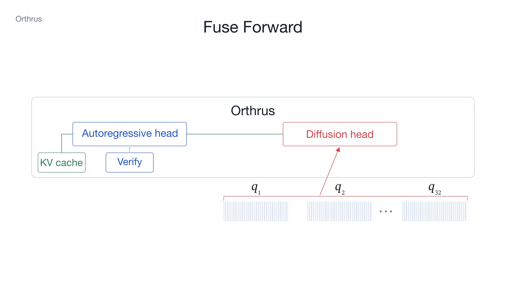

# Orthrus Parallel

**Verify the current draft and prepare its possible continuations in one transformer forward.**



https://github.com/user-attachments/assets/84153cfb-69dc-4e6b-b8ff-04827ef45cae

## How it works

Ordinary Orthrus alternates drafting and verification. Here, verification runs alongside several possible next drafts. When a branch matches the verifier's accepted prefix **and** next token, its continuation is already prepared. A miss falls back to a separate draft.

The default uses **16-token blocks**, considers **32 candidate anchors at each of 16 positions**, and selects **48 branches total**. Each branch reads the confirmed context and its assumed accepted prefix through causal AR states. Attention masks isolate branches from one another.

The selector scores pairs such as **“accept 3 proposals, then emit `return`”** using draft probabilities, position, token rank, the draft hidden state, and the candidate's embedding. A small MLP plus a learned hidden-state/token compatibility score ranks the pairs. All inputs exist before verification; no extra model forward is needed. [Details and a concrete example →](docs/method.md)

## Results

ZaryaOrthrus-0.6B · RTX 2080 Ti · FP16 · batch 1 · greedy · up to 256 new tokens.

| Method | Tokens/s |
|---|---:|
| Ordinary Orthrus | 58.28 |
| Parallel + selector | **69.57** |

**19.4% faster** (paired 95% interval: **17.0–22.1%**) across 30 held-out prompts, two repeats. Timing includes prefill, feature preparation, selection, and generation. Branch hit rate: **84.6%**. Outputs differed from ordinary Orthrus on **5 of 30 prompts**; exact equivalence and equal answer quality are not established. [Measurements and protocol →](benchmarks/README.md)

## Run

Requires Linux x86_64, an NVIDIA GPU, and [uv](https://docs.astral.sh/uv/).

```bash
uv sync --locked
uv run --locked python scripts/download_model.py             # inspect download plan
uv run --locked python scripts/download_model.py --download  # fetch pinned checkpoint

CUDA_VISIBLE_DEVICES=0 uv run --locked python -m orthrus_parallel \
  --checkpoint models/ZaryaOrthrus-0.6B/6c93071b27ab0d2061007dda0416f0439ed4d7df \
  --prompt 'Explain binary search briefly.'
```

Use `--method baseline` for ordinary Orthrus, or `--prompt-file`, `--max-new-tokens`, and `--output` to control a run. [Setup and checks →](docs/setup.md)

## Contents

- `orthrus_parallel/` — joint forward, masking, selector, and decoding loop.
- `weights/` — released selector and its fixed projections.
- `benchmarks/` — paired benchmark runner, sample prompts, and measured results.
- `tests/` — causal-mask, cache, and branch-equivalence checks.

## License

Original code and documentation: [MIT](LICENSE). The bundled selector weights have **separate noncommercial research terms**; model-derived embeddings retain upstream terms. See [NOTICE](NOTICE.md) before using or redistributing weights.
