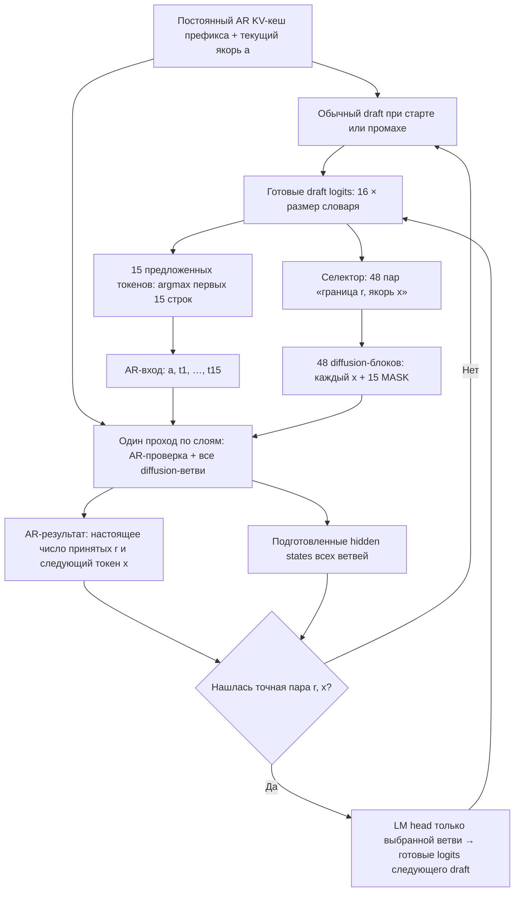
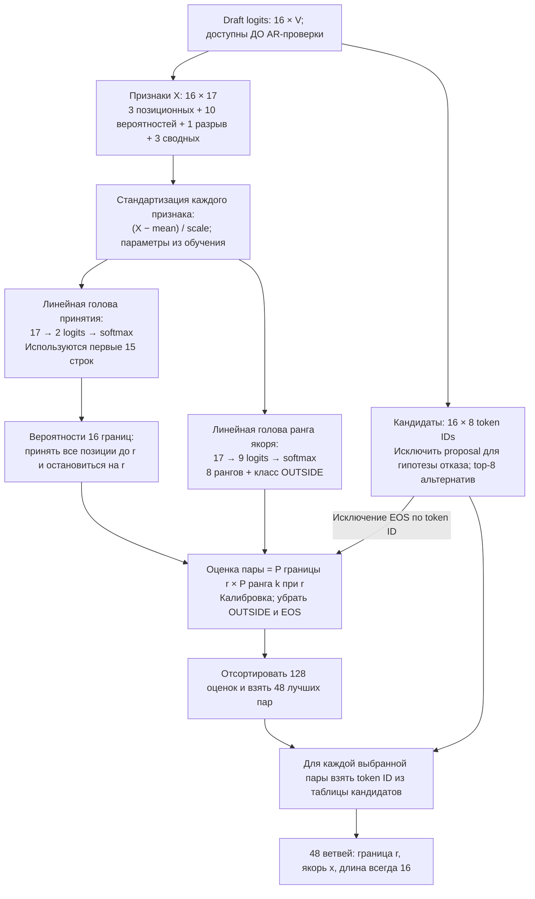

# Orthrus: параллельная проверка и подготовка продолжений

Этот проект ускоряет **greedy-инференс Orthrus**: пока авторегрессионная часть проверяет текущий draft, diffusion-часть готовит несколько возможных следующих блоков **в том же проходе по слоям**. Если одна из ветвей угадана, следующий отдельный draft-проход пропускается.

Лучшая из проверенных конфигураций — **блок 16 и линейный отбор 48 ветвей из 128 кандидатов**. На ZaryaOrthrus-0.6B она дала **59,25 токена/с против 52,45 у обычного Orthrus**, то есть **+13%**. Это результат небольшого фиксированного теста, а не универсальная гарантия ускорения.

## Результаты

Измерения **12 октября 2026**: `ai-forever/ZaryaOrthrus-0.6B`, RTX 2080 Ti, FP16, PyTorch SDPA, без `torch.compile`. 24 запроса: по 8 на код, математику и текст; два повтора; 288 генераций. Batch size — 1, максимум 256 новых токенов, greedy, thinking выключен.

| Режим | Что вычисляется | Токенов/с | Попадание в ветвь |
|---|---|---:|---:|
| `baseline16` | Обычный Orthrus, блок 16 | 52,45 | — |
| `baseline32` | Обычный Orthrus, блок 32 | 49,72 | — |
| `fixed48` | 48 ветвей по фиксированной таблице | 57,51 | 72,6% |
| `uniform80` | 5 якорей × 16 границ = 80 ветвей | 45,10 | 75,7% |
| `all128` | 8 якорей × 16 границ = 128 ветвей | 30,72 | 81,5% |
| **`selected48`** | **Линейный отбор 48 из 128 кандидатов** | **59,25** | **80,2%** |

Во всех режимах с ветвями блок содержит **один якорь и 15 масок**. Длина блока не предсказывается. Число 128 означает весь *рассматриваемый банк*, а не перебор всего словаря.

Отбор 48 ветвей даёт **+13,0% к обычному блоку 16** (95%-интервал: +9,8…15,5%) и **+3,0% к фиксированным 48 ветвям** (+1,9…4,3%). Почти та же частота попаданий, что у 128 ветвей, достигается при меньшем объёме вычислений. Широкий банк на этой GPU не окупается.

Измерено полное время генерации: prefill, признаки, селектор, ветви, проверка и draft при промахе. Загрузка модели и токенизация исключены. Все режимы одного запроса измерены на одной физической GPU в перемешанном порядке; две GPU делили запросы. Скорость — сумма выданных токенов / сумма времени. Bootstrap делается по **24 запросам**, сохраняя оба повтора вместе.

**Ограничения:** все варианты с ветвями дали одинаковые ответы между собой. С обычным блоком 16 ответы совпали на **19 из 24 запросов**; качество отдельно не оценивалось. В обоих повторах каждый режим повторил собственный ответ. Наличие расхождений в FP16 измерено, их причина этим тестом не изолирована.

Числа относятся к исходному экспериментальному коду. Рабочий пакет ниже — его очищенная реализация; проверки переноса находятся в [документе о проверке](docs/validation.md). Новый тест скорости после рефакторинга не подменяет исторические измерения.

Источники: [288 измерений](results/cv10_20261012/measurements.csv), [агрегаты, интервалы и проверки совпадений](results/cv10_20261012/summary.json).

## Как работает совместный проход

**Якорь** — первый известный токен следующего draft-блока. При обычном ходе его выбирает AR-голова. В заранее подготовленной ветви якорь пока является гипотезой.

Например, текущий draft предлагает 15 токенов. Ветка предполагает: «AR примет первые три, а следующим токеном будет `x`». Для этой ветви готовится блок `[x, MASK, …, MASK]`. Чтобы использовать его, нужно угадать **и число принятых токенов, и сам `x`**.



После проверки выдаём принятые токены и AR-выбранный следующий токен. Кеш обрезается до подтверждённого префикса; последний выданный токен остаётся **новым ещё не закешированным якорем**. На следующем цикле используются обновлённые кеш и якорь. Первый draft всегда нужен; перед концом ответа банк отключается, если целый следующий блок уже не поместится.

### Откуда ветви получают контекст

Пусть в кеше уже находится `P`, текущий якорь — `a`, предложения — `t1…t15`.

Ветка «приняты три токена, следующий — `x`» читает:

```text
AR-контекст:       P | a, t1, t2, t3
Diffusion-блок:                        x, MASK, …, MASK
                                      ↑ 16 позиций всего
```

`a, t1, t2, t3` вычисляются **с причинным AR-attention** в общем AR-потоке текущего прохода. Этот поток вычисляется один раз для всех ветвей. Ветка, предполагающая принятие восьми токенов, читает более длинный префикс того же AR-потока. Ранее закешированный `P` повторно не прогоняется через модель.

| Кто читает | Старый AR-кеш | Текущий AR-блок | Свой diffusion-блок | Другие ветви |
|---|---|---|---|---|
| AR-токен | Да | Только себя и предыдущие позиции | Нет | Нет |
| Diffusion-токен ветви с границей `r` | Да | `a` и первые `r` предложений | Все 16 позиций | Нет |

На каждом слое применяются AR-проекции для AR-строк и diffusion-проекции для ветвей, затем общий masked SDPA и общий MLP по объединённым строкам. **В постоянный кеш записываются только AR keys/values.** Diffusion-состояния не подставляются в AR-кеш. Якорь гипотетической ветви сам проходит diffusion-проекции; его AR-состояние появится при следующей AR-проверке, если ветвь выбрана.

«Один forward» здесь означает один проход по списку слоёв. Это не обещание одного CUDA-ядра. Код: [маска и совместный проход](orthrus_parallel/joint.py), [цикл генерации](orthrus_parallel/generation.py).

## Как линейная модель выбирает ветви

Селектор использует **уже полученные draft logits**. Отдельного кодирования текста или прохода по контексту нет. Контекст влияет на выбор **косвенно через эти logits**. Текст, token IDs кандидатов, embeddings и AR hidden states не поступают в линейные классификаторы.



**Вход одной строки — ровно 17 чисел:**

| Число | Признаки |
|---:|---|
| 3 | `16/32 = 0.5`, номер границы `r/15`, признак последней границы |
| 10 | Десять наибольших вероятностей токенов данной строки draft |
| 1 | Разность первой и второй вероятности |
| 3 | Средняя максимальная вероятность по блоку; средний разрыв; разрыв последней строки |

Вероятности нормализуются по **исходному полному словарю**, до исключения proposal из списка якорей. Энтропия и проекции embeddings не вычисляются; нормализатор по словарю всё ещё нужен. `mean` и `scale` у каждой головы свои, получены на обучении. Стандартизованный вектор умножается на матрицу весов, прибавляется bias, применяется softmax. Всего у двух голов **198 обучаемых коэффициентов**, не считая статистик нормализации.

Первая голова отвечает: **«если до этой позиции всё приняли, примут ли и этот токен?»** Из последовательности этих вероятностей получаем распределение места остановки. Вторая отвечает: **«каким по рангу среди восьми альтернатив окажется правильный якорь в этой позиции?»** Класс `OUTSIDE` означает, что восьмёрки недостаточно; ветвь для него построить нельзя.

Пример: если вероятность границы после трёх принятых токенов — `0.30`, а вероятность второго альтернативного якоря в этой строке — `0.40`, оценка пары равна `0.12` до калибровки. Для другой пары это может быть `0.10 × 0.80 = 0.08`. Сначала выбирается первая пара. Таким образом, **обучение — две классификации; применение — ранжирование пар по полученным вероятностям**. Это не линейное предсказание token ID и не авторегрессионная RNN.

На последних, 16-х logits нет отвергнутого proposal: они используются как эвристика для кандидата на bonus-токен при полном принятии 15 предложений. Его вероятность тоже предсказывается. Это не результат будущей AR-проверки.

Обучение для текущего checkpoint: 100 HumanEval-запросов / 800 состояний; валидация — 32 запроса / 256 состояний. Регуляризация выбиралась по валидации. Эти запросы не пересекаются с 24 запросами измерения скорости. Данные собирались на обычных свежих draft; применимость к состояниям после попадания проверяется итоговым инференсом, а не предполагается из обучающей метрики.

Код: [признаки и выбор](orthrus_parallel/selector.py). [Формулы и точные метки обучения](docs/selector.md). [Веса](selectors/zarya_06b/) содержат новую модель для 0.6B; `fixed48` использует историческую таблицу распределения ветвей.

## Запуск

Поддерживаемая проверенная среда: **Linux x86_64, NVIDIA GPU, Python 3.11.17, PyTorch 2.6.0+cu118, transformers 5.12.1**. Все зависимости закреплены в `uv.lock`. На Mac можно читать и проверять структуру проекта; CUDA-инференс выполняется на Linux-сервере.

```bash
# Один раз: установить локальный uv, затем окружение. Системный Python не меняется.
python3 bootstrap_uv.py
./lab sync --locked --no-dev --no-build

# Сначала показать размер и место назначения, затем явно скачать checkpoint.
./lab run --locked python scripts/download_model.py
./lab run --locked python scripts/download_model.py --download

# Генерация: 48 выбранных ветвей.
./lab run --locked python -m orthrus_parallel --method selected48 \
  --prompt 'Explain binary search with a Python example.' --max-new-tokens 256

# Обычный Orthrus для сравнения.
./lab run --locked python -m orthrus_parallel --method baseline16 \
  --prompt 'Explain binary search with a Python example.' --max-new-tokens 256
```

Окружение потребует несколько гигабайт загрузок; checkpoint с токенизатором — **1 555 948 837 байт**. Downloader показывает план без загрузки, фиксирует ревизию, проверяет размер и хеш каждого файла. Если модель уже есть, укажите `--checkpoint /path/to/checkpoint`; повторная копия не нужна. Выбирайте свободную GPU через `--gpu 0`.

`--prompt-file` читает запрос из файла, `--output runs/answer.json` сохраняет результат и счётчики, `--trace` добавляет детали циклов. Время одиночного холодного запроса не заменяет прогретый benchmark.

## Структура и воспроизводимость

```text
orthrus_parallel/     Читаемый рабочий код: маски, forward, селектор, генерация, CLI
selectors/zarya_06b/  Две линейные головы и их параметры
configs/             Закреплённый checkpoint и контрольные суммы
benchmarks/          Фиксированные запросы измерения скорости
results/             Числа исходного опыта и проверка рефакторинга
scripts/             Загрузка, обучение селектора, экспорт и проверка проекта
tests/              Проверки на настоящей модели и малой FP32-модели
docs/               Формулы, проверка и происхождение кода
archive/             Локальная неизменённая история; исключена из Git и экспорта
```

[Как воспроизвести обучение и измерения](docs/reproduction.md). [Происхождение и границы публикации](NOTICE.md).

```bash
# Проверить целостность результатов, документации и локального архива.
python3 scripts/check_repository.py

# Собрать только файлы репозитория, без моделей, сырых данных, логов и архива.
python3 scripts/export_repository.py --output /tmp/orthrus-parallel.tar.gz
```

Результаты и исходники старого опыта сохранены побайтово в `archive/cv10_20261012/`. Архив нужен для аудита исходных измерений; рабочий пакет не импортирует из него код. Экспорт не публикует ничего во внешний сервис и не создаёт Git-коммит.
