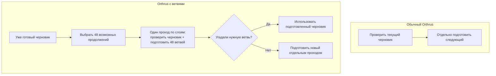
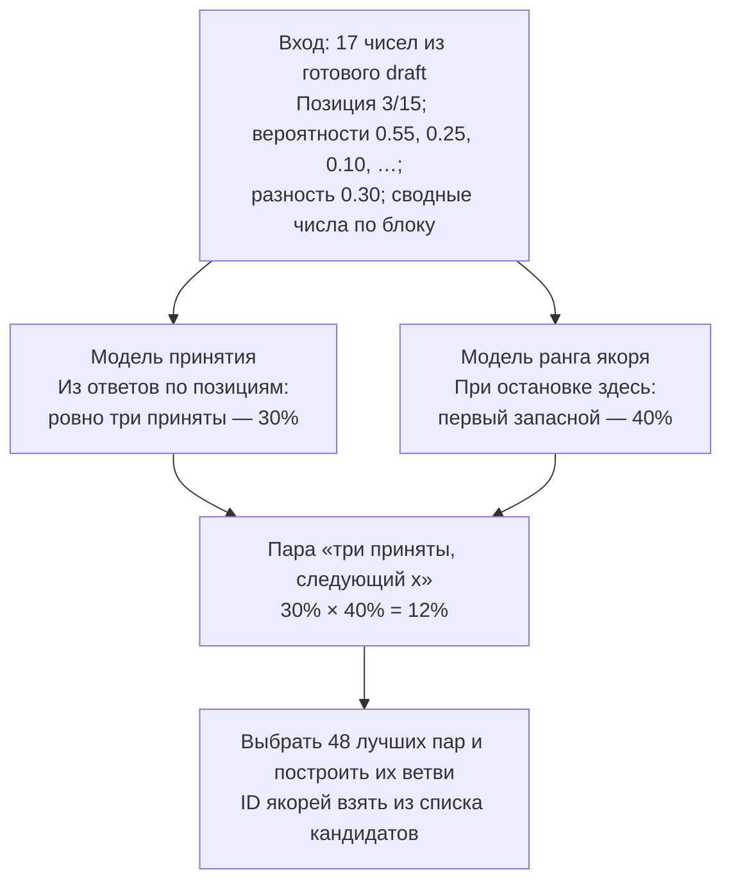
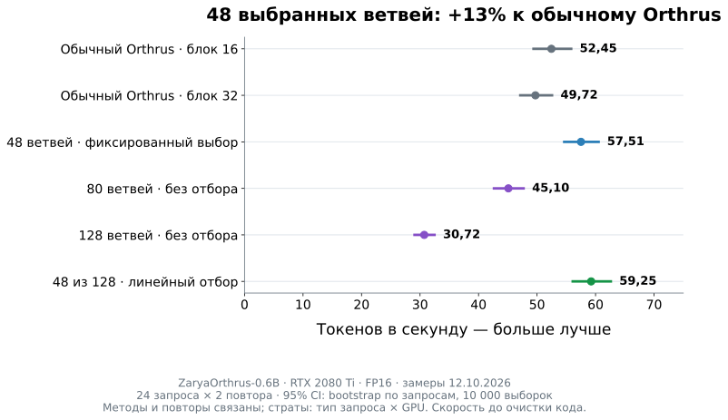

# Orthrus: готовим следующий блок, пока проверяем текущий

Обычный Orthrus чередует два шага: **предлагает токены** (draft) и **проверяет их авторегрессионной частью** (AR). Мы совмещаем проверку с подготовкой нескольких возможных продолжений. Если нужное продолжение уже готово, отдельный шаг draft пропускается.

## Один проход вместо двух



**Ветвь — это предположение о двух вещах:** сколько токенов примет проверка и какой токен она выдаст следующим. Например: «примет первые три, следующим будет `x`». Токен `x` называем **якорем** следующего блока. Для этой гипотезы модель получает:

```text
Сохранённый контекст      Текущие токены, посчитанные через AR
        P             |       a   t1   t2   t3
                      └───────────┬───────────┘
                           ветвь читает их
                                  ↓
Вход ветви:                  x   MASK × 15
Результат:                   черновик следующих 15 токенов
```

Здесь `a` — текущий подтверждённый якорь, `t1…t3` — первые три предложения черновика. **Весь текущий AR-блок считается один раз**; каждая ветвь читает разрешённый ей префикс. Старый контекст `P` берётся из кеша. Ветви не видят друг друга, AR не видит ветви. В постоянный кеш попадают только AR-состояния.

После проверки используем ветвь, только если **совпали и число принятых токенов, и якорь**. Первый черновик всегда строится отдельно. [Точная маска и работа кеша →](docs/parallel.md)

## Что получает и предсказывает селектор

У черновика уже есть вероятности токенов. Из них выбираем восемь возможных якорей для каждой из 16 границ: **128 кандидатов**. Селектор оставляет **48 ветвей** для вычисления. Длина каждой фиксирована: якорь + 15 масок.

Ниже **условный пример**, а не результат обученных весов. Для позиции после трёх предложений черновик оценил токены так:

| Токен | Вероятность черновика | Его роль |
|---|---:|---|
| `t4` | 55% | Текущее предложение; при отказе исключаем |
| `x` | 25% | Первый запасной якорь |
| `y` | 10% | Второй запасной якорь |
| Остальные | 10% суммарно | Другие кандидаты |

**Классификаторы получают числа, а не слова:** вероятности десяти лучших токенов, номер позиции и несколько сводных чисел по блоку. Например, разность первых двух вероятностей здесь — `55% − 25% = 30%`. Контекст уже повлиял на эти вероятности; заново кодировать его не требуется.



Первая модель предсказывает, примут ли очередной токен, **если все предыдущие приняты**. Вторая — **ранг следующего токена при остановке здесь**: от первого до восьмого запасного, либо «за пределами восьмёрки».

Каждая линейная модель нормализует входные числа, умножает их на обученные веса и превращает оценки в вероятности классов. Обучение — **две классификации**, выбор ветвей — **сортировка оценок пар**. В примере `25%` — вероятность токена у draft, а `40%` — предсказание селектора о выборе AR: это разные величины. [Все 17 входов, формулы и метки обучения →](docs/selector.md)

## Что получилось по скорости

**Исторический тест, 12 октября 2026:** ZaryaOrthrus-0.6B, RTX 2080 Ti, FP16, обычный PyTorch SDPA. 24 запроса, два повтора каждого режима. Время включает подготовку входов, селектор и вычисление ветвей.



Отбор 48 ветвей дал **59,25 токена/с: +13% к обычному блоку 16 и +3% к фиксированным 48 ветвям**. Попадание выросло с **72,6% до 80,2%**. Вычислять все 128 оказалось дороже, чем иногда строить черновик после промаха.

**Границы результата:** ответы совпали с обычным режимом на **19 из 24 запросов**; качество отдельно не проверялось. Числа измерены до очистки кода. Перенос проверен на совпадение с исходной реализацией, но новый замер скорости ещё не проведён. [Все измерения и условия →](docs/benchmark.md)

## Попробовать

Нужны Linux, NVIDIA GPU и [подготовленное окружение через uv](docs/setup.md).

```bash
./lab run --locked python -m orthrus_parallel --method selected48 \
  --prompt 'Explain binary search with a Python example.' --max-new-tokens 256
```

[Код общего прохода](orthrus_parallel/joint.py) · [Код селектора](orthrus_parallel/selector.py) · [Воспроизводимость](docs/reproduction.md) · [Проверки](docs/validation.md) · [Происхождение кода](NOTICE.md)
