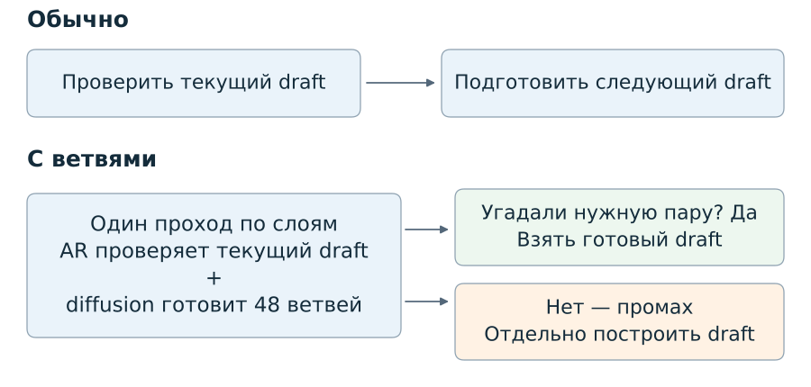
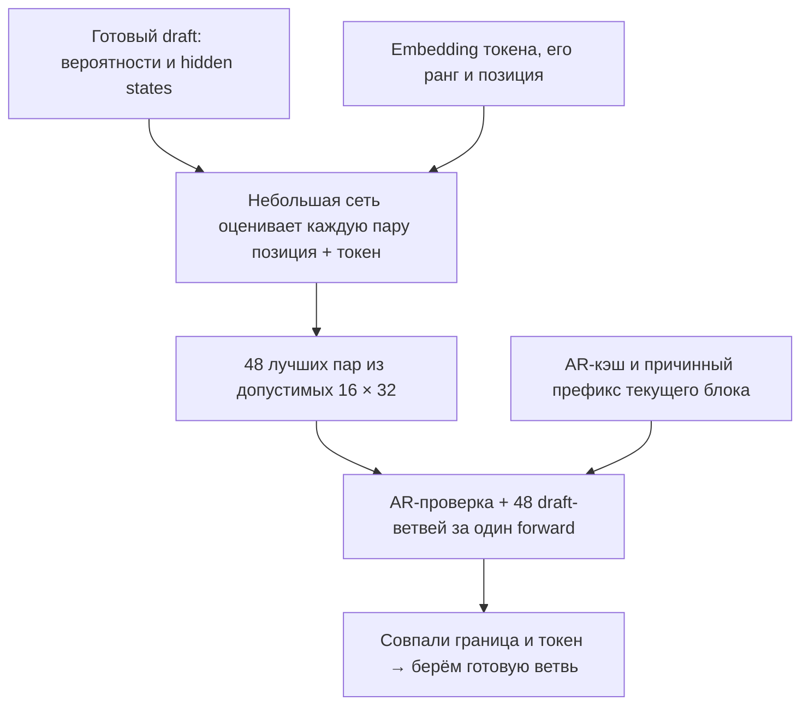

# Orthrus: следующий draft одновременно с проверкой

Обычный Orthrus предлагает блок токенов и проверяет его авторегрессионной частью. Здесь проверка одновременно готовит несколько возможных продолжений. Если угадали продолжение, отдельный draft пропускается.

**[Смотреть видео: параллельный forward и отбор ветвей — 3:05](docs/videos/orthrus-parallel-and-selector.mp4)**

Совместная проверка и генерация, маска внимания; с **1:20** — зачем нужен селектор, его входы, выбор top-48 и результаты. Анимация на английском.



**Ветвь — пара «сколько предложений примут + какой токен выдаст AR следующим».** Например: «примут три, следующим будет `return`». Токен `return` становится якорем следующего блока.

Контекст этой ветви: подтверждённый AR-кэш + текущий якорь и три предложения, заново вычисленные через причинный AR-attention в том же общем forward. Вход самой ветви — `return` и 15 масок. Весь текущий AR-блок вычисляется один раз. Ветви друг друга не видят; в постоянный кэш попадают только AR key/value. [Маска и кэш →](docs/parallel.md)

## Как выбираем ветви

Основной draft и каждая ветвь имеют длину **16**. На каждой из 16 границ рассматриваем до **32 токенов-якорей**, затем оставляем **48 лучших пар суммарно**.



Сеть получает уже доступные вероятности/уверенность draft, его hidden state на позиции, embedding кандидата и сведения о текущем цикле. Предсказывает правильную пару, а не длину блока. Большая модель ради селектора дополнительно не запускается. Общая подготовка оценивает 16×64 пары, затем исключает ранги выше 32; это время учтено.

Основной вариант — top-32 токена-якоря на позицию и селектор, который оставляет 48 ветвей. Селектор — небольшая сеть с обучаемым сопоставлением hidden state и embedding. [Что сравнили и как обучали →](docs/selector_training_20261015.md)

## Скорость: независимый тест 15 октября 2026

ZaryaOrthrus-0.6B, RTX 2080 Ti, native FP16, блоки 16. **30 новых запросов × 2 повтора**; время включает prefill, признаки, селектор и генерацию.

| Вариант | Токенов/с |
|---|---:|
| Обычный Orthrus | 58,28 |
| **Top-32 + селектор → 48 ветвей** | **69,57** |

[График сравнения конфигураций](docs/figures/speed_test.svg)

**Top-32 + селектор: +19,4% к обычному Orthrus**, парный 95%-интервал [17,0; 22,1]%. Попадание в нужную ветвь — 84,6% среди циклов, где банк может пригодиться. Если нужной пары нет, выполняется отдельный draft.

С обычным Orthrus ответы различались на 5/30 запросах; универсальная эквивалентность и сохранение качества не доказаны. Результат не переносится автоматически на другое оборудование или длинные генерации. [Отчёт и графики →](docs/selector_training_20261015.md)

## Запуск

На Linux с NVIDIA GPU и установленным uv:

```bash
uv sync --project learned_selector --locked
CUDA_VISIBLE_DEVICES=0 uv run --project learned_selector --locked --no-sync python \
  learned_selector/infer.py --checkpoint /path/to/ZaryaOrthrus-0.6B \
  --prompt 'Explain binary search briefly.' --max-new-tokens 256
```

[Точная версия checkpoint и инструкция →](learned_selector/README_RU.md). Веса селектора приложены; базовая модель скачивается отдельно. Прежние режимы доступны через [старый CLI](docs/setup.md).

[Воспроизводимость](docs/selector_reproduction.md) · [Измерения](results/selector_training_20261015/analysis_test.json) · [Проверки поставки](results/selector_training_20261015/publication_validation.json) · [Исторический тест 12 октября](docs/benchmark.md) · [Происхождение](NOTICE.md)
