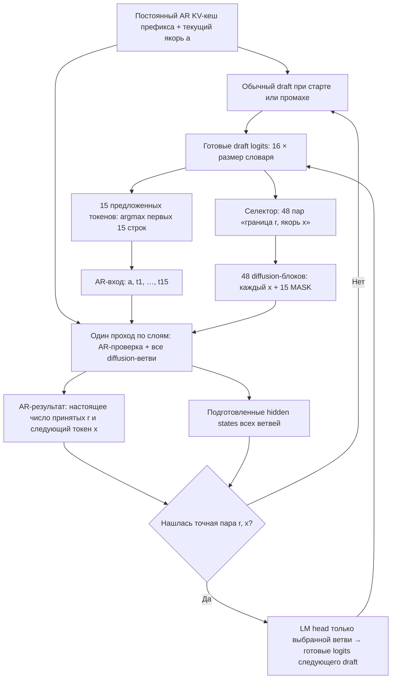

# Совместный проход: маска и кеш


**Якорь** — первый известный токен следующего draft-блока. При обычном ходе его выбирает AR-голова. В заранее подготовленной ветви якорь пока является гипотезой.

Например, текущий draft предлагает 15 токенов. Ветка предполагает: «AR примет первые три, а следующим токеном будет `x`». Для этой ветви готовится блок `[x, MASK, …, MASK]`. Чтобы использовать его, нужно угадать **и число принятых токенов, и сам `x`**.



После проверки выдаём принятые токены и AR-выбранный следующий токен. Кеш обрезается до подтверждённого префикса; последний выданный токен остаётся **новым ещё не закешированным якорем**. На следующем цикле используются обновлённые кеш и якорь. Первый draft всегда нужен; перед концом ответа банк отключается, если целый следующий блок уже не поместится.

### Откуда ветви получают контекст

Пусть в кеше уже находится `P`, текущий якорь — `a`, предложения — `t1…t15`.

Ветка «приняты три токена, следующий — `x`» читает:

```text
AR-контекст:       P | a, t1, t2, t3
Diffusion-блок:                        x, MASK, …, MASK
                                      ↑ 16 позиций всего
```

`a, t1, t2, t3` вычисляются **с причинным AR-attention** в общем AR-потоке текущего прохода. Этот поток вычисляется один раз для всех ветвей. Ветка, предполагающая принятие восьми токенов, читает более длинный префикс того же AR-потока. Ранее закешированный `P` повторно не прогоняется через модель.

| Кто читает | Старый AR-кеш | Текущий AR-блок | Свой diffusion-блок | Другие ветви |
|---|---|---|---|---|
| AR-токен | Да | Только себя и предыдущие позиции | Нет | Нет |
| Diffusion-токен ветви с границей `r` | Да | `a` и первые `r` предложений | Все 16 позиций | Нет |

На каждом слое применяются AR-проекции для AR-строк и diffusion-проекции для ветвей, затем общий masked SDPA и общий MLP по объединённым строкам. **В постоянный кеш записываются только AR keys/values.** Diffusion-состояния не подставляются в AR-кеш. Якорь гипотетической ветви сам проходит diffusion-проекции; его AR-состояние появится при следующей AR-проверке, если ветвь выбрана.

«Один forward» здесь означает один проход по списку слоёв. Это не обещание одного CUDA-ядра. Код: [маска и совместный проход](../orthrus_parallel/joint.py), [цикл генерации](../orthrus_parallel/generation.py).

