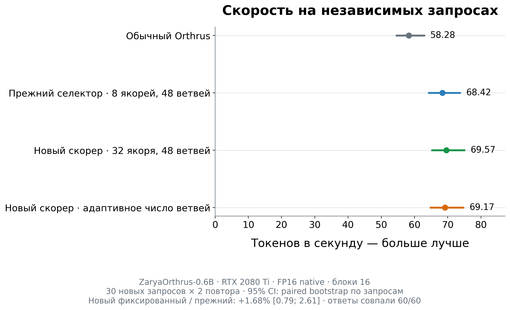
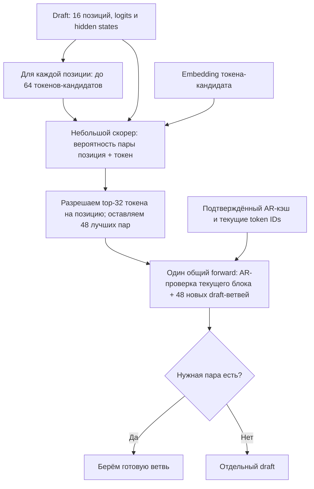
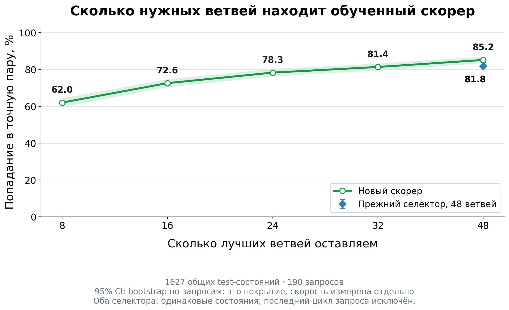

# Селектор ветвей Orthrus: результат

**Новый селектор ускорил генерацию на 1,68% относительно прежнего; 95%-интервал — от +0,79% до +2,61%.** Это результат независимого теста, а не точность на обучении.

| Вариант | Токенов/с |
|---|---:|
| Обычный Orthrus | 58,28 |
| Прежний селектор: до 8 якорей на позицию → 48 ветвей | 68,42 |
| Новый селектор: до 32 якорей на позицию → 48 ветвей | **69,57** |
| Новый селектор с переменным числом ветвей | 69,17 |

Все варианты: ZaryaOrthrus-0.6B, блоки по 16, native FP16, RTX 2080 Ti на CV10. Тест: 30 новых запросов по коду, математике и тексту, по два повтора. Время включает prefill, признаки, выбор и все проходы генерации. Загрузка модели и токенизация исключены. Настройки выбраны до открытия теста. Новый вариант быстрее на 21 из 30 запросов; медианный прирост — 1,20%, худший случай — −6,20%.

## Что выбирает модель

Селектор оценивает пару **«где закончится принятие текущего draft + какой токен выдаст AR-проверка следующим»**. Выбирает 48 наиболее перспективных пар. Это 48 ветвей суммарно, а не на каждую позицию.

На вход идут уже полученные вероятности draft, ранг кандидата, позиция, уверенность соседних предсказаний, сведения о текущем цикле, hidden state draft на этой позиции и embedding конкретного токена. Большая модель дополнительный проход ради селектора не делает. Представление прошлого AR-контекста тоже проверили; в победившей модели оно не используется.

Например, пара «после трёх принятых предложений, следующий токен `return`» задаёт ветвь, которая читает подтверждённый контекст и эти три токена **через причинный AR-attention**, затем получает `return` и маски будущего блока. Это иллюстрация интерфейса, а не измеренный прогноз. Diffusion hidden states не подменяют AR-кэш. Ветви друг друга не видят; в постоянный кэш попадают только AR key/value.

Технически общий скорер оценивает все 16×64 пары, после чего запрещает ранги выше 32. Стоимость этой подготовки включена в скорость.

## Что проверили

Собрали **17 976 состояний**, потолок 20 тысяч соблюдён. После удаления близких дубликатов: 14 264 для обучения, 1 815 для валидации, 1 817 для теста. Запросы и обнаруженные семейства задач разделены; тест не участвовал в настройке.

| Способ | Что обучали | Результат отбора |
|---|---|---|
| Произведение вероятностей | Калибровку вероятности остановки и токена | Простой ориентир; не лучший |
| Прежняя линейная модель | Два классификатора: принятие позиции и ранг токена | Переобучена на большем наборе |
| Общий линейный скорер | Классификацию правильной пары | Уступил небольшим сетям |
| CatBoost | Классификацию, групповое ранжирование, регрессию вероятности | Классификация лучше ранжирования; выбор дороже |
| MLP | Классификацию пары; отдельно ranking и Brier loss | Хорошая точность, но не лучшая полная скорость |
| **MLP + билинейное сопоставление hidden/token** | **Классификацию пары** | **Лучший подтверждённый вариант** |

Для основных сетей сравнили три seed и добавление hidden states / AR-контекста. Вложенные обучающие наборы около 4/8/14 тысяч состояний улучшили Recall@32 обычного hidden-MLP: 81,47% → 82,25% → 83,25% на валидации. Это попадание в 32 выбранные пары, не ускорение. Классификация оказалась предпочтительнее проверенных ranking/Brier вариантов. Результаты всех конфигураций сохранены в `results/selector_training_20261015/{trained,trained_bilinear,catboost_models}_summary.json`.

Три финалиста прошли реальные замеры с 16, 24, 32 и 48 ветвями. Затем отдельно проверили адаптивный банк. Всего — **672 замеренные генерации**. На тест вынесли заранее зафиксированную конфигурацию.

## Почему выигрыш небольшой

В реальной генерации попадание в нужную ветвь выросло **с 80,87% до 84,65%** среди циклов, где банк мог пригодиться. Отдельных draft стало **640 → 552**, на 13,75% меньше. Доля циклов с готовым draft выросла с 74,48% до 77,96%. Но признаки и выбор теперь стоят около 1,40 мс против 0,85 мс на одном проверенном валидационном состоянии. Поэтому улучшение попаданий превращается лишь в небольшой прирост полной скорости. Это измеренная составляющая затрат, а не полный причинный разбор каждого микросекундного расхода.

Потенциал top-64 действительно высок: нужная пара присутствует в 96,89% продолжающихся сохранённых тестовых состояний. Это потолок кандидатов, которого обученный селектор пока не достигает. Банки меньшего размера теряют достаточно попаданий, чтобы экономия не окупалась. Адаптивная политика почти всегда оставляет 48 ветвей и быстрее фиксированного варианта не стала.

## Корректность и границы

Новый и прежний ветвящийся варианты выдали одинаковые token IDs во всех **60/60** тестовых генерациях. С обычным Orthrus ответы расходятся на 5 из 30 запросов; случаи разобраны в `results/selector_training_20261015/quality_review.json`. Такой разбор не заменяет бенчмарк качества, и эквивалентность обычному декодированию не установлена.

Вывод относится к этой модели, оборудованию и коротким генерациям до 256 токенов. Обучающие состояния в основном из ранних циклов; перенос на длинные продолжения не проверен. Время до первого токена отдельно не измеряли. Интервалы получены парным bootstrap по запросам с сохранением повторов и группировкой по домену/GPU; отдельной внешней пререгистрации нет.

Opus 5.5 проверил план и затем пакет агрегированных результатов. Его итог: сообщать скромный тестовый выигрыш, не настраиваться по открытому тесту. Это консультация, не независимый аудит исходного кода. Решения сохранены в `docs/selector_review.md`.

**Готовый запуск:** [release/README_RU.md](../learned_selector/README_RU.md). **Воспроизведение исследования:** [REPRODUCTION_RU.md](selector_reproduction.md). **Проверки:** [completion_audit.json](../results/selector_training_20261015/completion_audit.json). Код, состояния и обученные селекторы восстановлены локально; базовый checkpoint в копию не входит.
